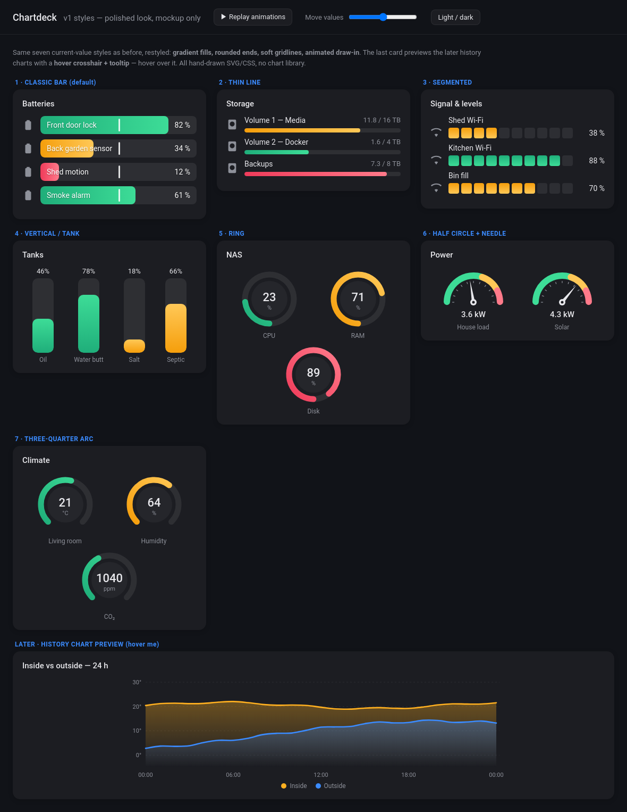

<h1 align="center">Chartdeck</h1>

  <strong>Bars, gauges and charts for Home Assistant dashboards.</strong> 
  Every style set up from the visual editor, drawn by the card itself, and themed to match
  your dashboard in light and dark.

  
  
  
  
  

  
  
  
  

> **Chartdeck is in early development.** The first release brings the bar and gauge styles
> below; history charts follow. See the [Roadmap][roadmap] for what is coming and in what order.

📖 **The documentation is in the [wiki][wiki]**, also published as a [searchable site][pages].
This page is the summary. What changed in each version is on the [releases page][releases].

## Why Chartdeck

- **Everything from the visual editor.** Pick entities, choose a style, set colour bands
  and limits without writing YAML. YAML still works, and the editor and YAML always agree.
- **One card, many styles.** Switching from a bar to a ring or a gauge is one setting. Colour
  bands, actions, names and limits carry across.
- **No chart library.** Every style is drawn by the card's own code, so it stays small, loads
  fast on wall tablets, and follows your Home Assistant theme.
- **Limits from anywhere.** Minimum, maximum and target can each be a number or another
  entity.

## Styles

| Style | Good for | Status |
| --- | --- | --- |
| Classic bar | Batteries, levels, anything 0–100 | First release |
| Thin bar | Storage, compact lists | First release |
| Segmented bar | Signal strength, fill levels | First release |
| Vertical / tank | Tanks, bins, water butts | First release |
| Ring | CPU, memory, disk | First release |
| Half circle with needle | Power, speed | First release |
| Three-quarter arc | Temperature, humidity, CO₂ | First release |
| Line, area and column charts | History over hours and days | [Planned][roadmap] |
| Pie, donut, pictograph, tally | Sharing out a total, counting | [Planned][roadmap] |
| Histogram, scatter, heatmap and more | Patterns over weeks | [Planned][roadmap] |

## Installation

Until Chartdeck is in the HACS default list, add it as a custom repository:

1. Open HACS, choose ⋮ → **Custom repositories**.
2. Add `https://github.com/tempus2016/chartdeck` with the type **Dashboard**.
3. Search for *Chartdeck*, download it, and reload your browser.

To install by hand, save [chartdeck-card.js][latest-release] to `<config>/www/` and add
`/local/chartdeck-card.js` as a dashboard resource of type `module`. The
[Installation][wiki-installation] page has the detail.

## Getting started

Edit a dashboard, choose **Add card**, and search for **Chartdeck**. The editor walks you
through the rest. The [Quick start][wiki-quick-start] shows the same in pictures.

## Help and feedback

- Something not right? Check [Troubleshooting][wiki-troubleshooting], then
  [open an issue][issues].
- Want a chart type that is not here yet? Use the
  [New chart type][new-chart] form — the votes on those decide what comes next.
- Questions and dashboards to show off go in [Discussions][discussions].

## Contributing

See [CONTRIBUTING.md](CONTRIBUTING.md). Translations are the easiest place to start.

## Licence

[MIT](LICENSE).

[wiki]: https://github.com/tempus2016/chartdeck/wiki
[pages]: https://tempus2016.github.io/chartdeck/
[releases]: https://github.com/tempus2016/chartdeck/releases
[latest-release]: https://github.com/tempus2016/chartdeck/releases/latest
[roadmap]: https://github.com/tempus2016/chartdeck/wiki/Roadmap
[wiki-installation]: https://github.com/tempus2016/chartdeck/wiki/Installation
[wiki-quick-start]: https://github.com/tempus2016/chartdeck/wiki/Quick-Start
[wiki-troubleshooting]: https://github.com/tempus2016/chartdeck/wiki/Troubleshooting
[issues]: https://github.com/tempus2016/chartdeck/issues
[new-chart]: https://github.com/tempus2016/chartdeck/issues/new?template=new_chart_type.yml
[discussions]: https://github.com/tempus2016/chartdeck/discussions
