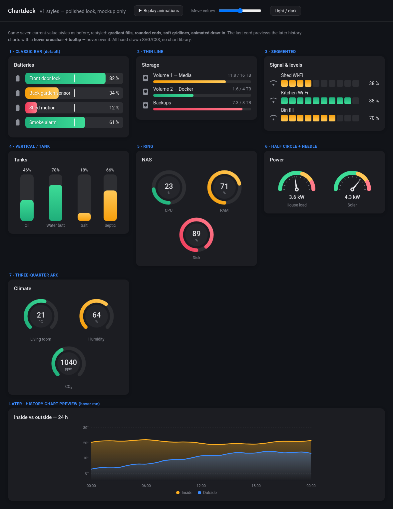

<h1 align="center">Chartdeck</h1>

<p align="center">
  <strong>Bars, gauges and charts for Home Assistant dashboards.</strong><br>
  Every style set up from the visual editor, drawn by the card itself, and themed to match
  your dashboard in light and dark.
</p>

<p align="center">
  <a href="https://github.com/tempus2016/chartdeck/releases"></a>
  <a href="https://github.com/hacs/integration"></a>
  <a href="https://github.com/tempus2016/chartdeck/blob/main/LICENSE"></a>
  
  <a href="https://github.com/tempus2016/chartdeck/releases"></a>
  <a href="https://community.home-assistant.io/t/chartdeck-bars-and-gauges-for-your-dashboard-all-set-up-from-the-visual-editor/1030685"></a>
</p>

<p align="center">
  <a href="https://github.com/tempus2016/chartdeck/actions/workflows/build.yml"></a>
  <a href="https://github.com/tempus2016/chartdeck/actions/workflows/hacs.yml"></a>
  <a href="https://github.com/tempus2016/chartdeck/actions/workflows/codeql.yml"></a>
  <a href="https://github.com/tempus2016/chartdeck/commits/main"></a>
</p>

> **2.0 adds the rest of the roadmap: parts of a total, distributions, comparisons, flows, hierarchies, and zoom, annotations and more on the line chart.** Ideas for what comes next are on the
> [roadmap board][roadmap].



📖 **The documentation is in the [wiki][wiki]**, also published as a [searchable site][pages].
This page is the summary. What changed in each version is on the [releases page][releases].

## Why Chartdeck

- **Everything from the visual editor.** Pick entities, choose a style, set colour bands
  and limits without writing YAML. YAML still works, and the editor and YAML always agree.
- **One card, many styles.** Switching from a bar to a ring or a gauge is one setting. Colour
  bands, actions, names and limits carry across.
- **No chart library.** Every style is drawn by the card's own code, so it stays small, loads
  fast on wall tablets, and follows your Home Assistant theme.
- **Limits from anywhere.** Minimum, maximum and target can each be a number or another
  entity.

## Styles

| Style | Good for | Status |
| --- | --- | --- |
| Classic bar | Batteries, levels, anything 0–100 | 1.0 |
| Thin bar | Storage, compact lists | 1.0 |
| Segmented bar | Signal strength, fill levels | 1.0 |
| Vertical / tank | Tanks, bins, water butts | 1.0 |
| Ring | CPU, memory, disk | 1.0 |
| Half circle with needle | Power, speed | 1.0 |
| Three-quarter arc | Temperature, humidity, CO₂ | 1.0 |
| Line chart | How a sensor changed over hours, days or months | 1.2 |
| Area chart | Solar, power use, import and export either side of zero | 1.3 |
| Column chart | Energy per day, rain per hour | 1.3 |
| Combined chart | Columns, lines and areas on one time axis, with a second axis | 1.3 |
| Pie and donut | How a total splits into parts, such as where today's energy came from | 2.0 |
| Rings | Several batteries or goals in one dial | 2.0 |
| Pictograph | Counting: chores done, glasses of water, people at home | 2.0 |
| Waffle | One share out of 100, or a split of one total | 2.0 |
| Histogram | How long a room spent in each temperature range | 2.0 |
| Scatter | One sensor against another, such as heating against outside temperature | 2.0 |
| Bubble | A scatter sized by a third sensor: temperature, humidity and CO₂ | 2.0 |
| Heatmap | Power by hour and weekday, or a year of days as a calendar | 2.0 |
| Box plot | How readings spread, per entity or per day, week or month | 2.0 |
| Funnel | Solar produced, used in the house, exported | 2.0 |
| Waterfall | How a total is built up or worn down, step by step | 2.0 |
| Treemap | Power use by floor and room | 2.0 |
| Sunburst and icicle | A hierarchy as rings or bars, tap to drill in | 2.0 |
| Radar | Comparing profiles of several values | 2.0 |
| Polar area | Values as slice lengths around a circle | 2.0 |
| Grouped and stacked bars | Several values side by side, stacked or as 100 % | 2.0 |
| Bullet and lollipop | A value against its target; many values with little ink | 2.0 |
| Slope and dumbbell | Each entity then and now, or its lowest and highest | 2.0 |
| Range area | Each period's lowest to highest, shaded | 2.0 |
| Sparklines | A tiny trend beside each entity's name and value | 2.0 |
| Streamgraph | How several entities share a total over time | 2.0 |
| Candlestick | Open, high, low and close per period | 2.0 |
| Violin, raincloud and beeswarm | How readings are spread, or every reading as a dot | 2.0 |
| State timeline | When each entity was on, off, home or heating | 2.0 |
| Climate | A thermostat's temperature against its set point | 2.0 |
| Sankey | How power flows between sources and loads | 2.0 |
| Wind rose | Where the wind comes from, and how hard | 2.0 |
| 24-hour clock | When each entity was on, around the clock | 2.0 |
| Trend card | A compact tile: the value over its recent history | 2.0 |
| Line chart extras | Zoom and pan, annotations, value labels, synced charts, small multiples, highest/lowest/average marks, log scale | 2.0 |

## Installation

Chartdeck is in the HACS default store:

1. Open HACS and search for *Chartdeck*.
2. Download it, then reload your browser.

[](https://my.home-assistant.io/redirect/hacs_repository/?owner=tempus2016&repository=chartdeck&category=lovelace)

To install by hand, save [chartdeck-card.js][latest-release] to `<config>/www/` and add
`/local/chartdeck-card.js` as a dashboard resource of type `module`. The
[Installation][wiki-installation] page has the detail.

## Getting started

Edit a dashboard, choose **Add card**, and search for **Chartdeck**. The editor walks you
through the rest. The [Quick start][wiki-quick-start] shows the same in pictures.

## Quick start

```yaml
type: custom:chartdeck-card
style: ring
entities:
  - sensor.cpu_usage
severity:
  - from: 0
    color: green
  - from: 80
    color: red
```

Every option is in the [wiki][wiki].

## Help and feedback

- Something not right? Check [Troubleshooting][wiki-troubleshooting], then
  [open an issue][issues].
- Want a chart type that is not here yet? Use the
  [New chart type][new-chart] form — the votes on those decide what comes next.
- Questions and dashboards to show off go in [Discussions][discussions].

## Contributing

See [CONTRIBUTING.md](CONTRIBUTING.md). Translations are the easiest place to start.

## Licence

[MIT](LICENSE).

[wiki]: https://github.com/tempus2016/chartdeck/wiki
[pages]: https://tempus2016.github.io/chartdeck/
[releases]: https://github.com/tempus2016/chartdeck/releases
[latest-release]: https://github.com/tempus2016/chartdeck/releases/latest
[roadmap]: https://github.com/users/tempus2016/projects/5
[wiki-installation]: https://github.com/tempus2016/chartdeck/wiki/Installation
[wiki-quick-start]: https://github.com/tempus2016/chartdeck/wiki/Quick-Start
[wiki-troubleshooting]: https://github.com/tempus2016/chartdeck/wiki/Troubleshooting
[issues]: https://github.com/tempus2016/chartdeck/issues
[new-chart]: https://github.com/tempus2016/chartdeck/issues/new?template=new_chart_type.yml
[discussions]: https://github.com/tempus2016/chartdeck/discussions
